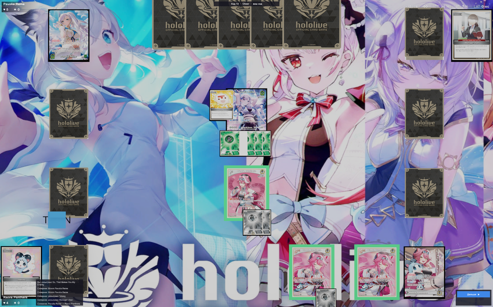
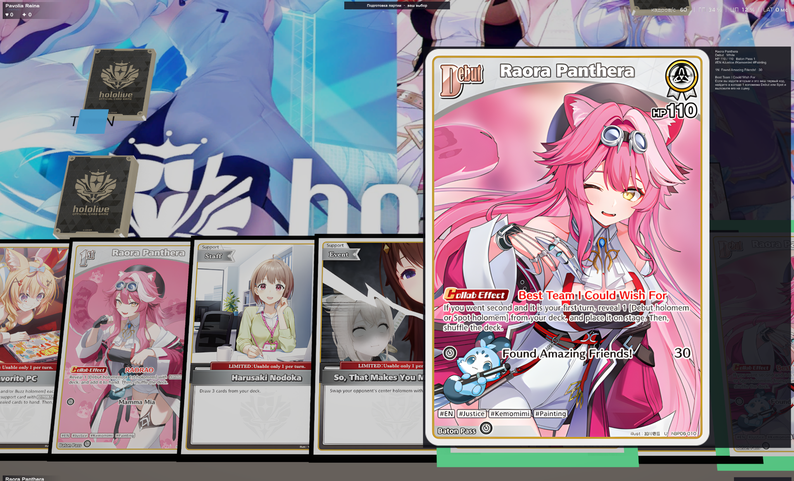

# Hololive TCG — Unity Fan Project

> Неофициальный фанатский цифровой проект по мотивам **hololive OFFICIAL CARD GAME**. Не связан с правообладателями и не одобрен ими.

## О проекте

Карточная настольная игра, созданная в Unity. Реализован визуальный игровой стол, отображение карт и колод, увеличение выбранной карты для чтения характеристик и эффектов. Поддерживается сетевая игра, включая присоединение к партии по коду.

**Статус:** готовая игровая сборка. В репозитории могут публиковаться исходники Unity и документация; готовые версии рекомендуется размещать в [Releases](../../releases).

## Скриншоты

## Возможности

- Игровое поле с зонами размещения карт и рукой игрока.
- Просмотр увеличенной карты, её характеристик и текста эффектов.
- Различные выпуски карт и стартовые колоды.
- Сетевая игра и подключение к партии по коду.
- Готовая сборка игры.

## Карточные наборы

Ниже — перечень наборов из рабочего списка проекта. Обозначения `+`, `-` и `?` сохранены из исходного списка: **без отдельной проверки нельзя считать все перечисленные наборы полностью реализованными**.

| Набор | Отметка | Количество |
|---|:---:|---:|
| Extra Booster – Summer hologram | + | 214 |
| Start Deck – Oshi Advent | - | 26 |
| Start Deck – Oshi Justice | + | 25 |
| Entry Cup – Ayakashi Vermilion | ? | 561 |
| Booster Pack – Ayakashi Vermilion | + | 282 |
| Booster Pack – Enchant Regalia | - | 232 |
| Booster Pack – Curious Universe | - | 241 |
| Booster Pack – Elite Spark | + | 244 |
| Start Deck – White Todoroki Hajime | - | 20 |
| Start Deck – Green Kazama Iroha | - | 20 |
| Start Deck – Yellow Shiranui Flare | - | 20 |
| Booster Pack – Quintet Spectrum | + | 219 |
| Start Deck – Red Nakiri Ayame | + | 20 |
| Start Deck – Blue Nekomata Okayu | + | 20 |
| Start Deck – Purple Yuzuki Choco | - | 20 |
| Start Deck – Tokino Sora & AZKi | + | 24 |
| Booster Pack – Blooming Radiance | - | 252 |
| Start Cheer Set | ? | 8 |
| PROMO CARDS | ? | 141 |

## Технологии и участие в разработке

- **Unity**, **C#**.
- Концепция, постановка задач, тестирование и итерации игрового процесса — автор проекта.
- Программная реализация преимущественно создана с помощью ИИ. Проект представлен как опыт организации и доведения до результата игрового приложения, а не как пример полностью самостоятельно написанного C#-кода.

## Как запустить

1. Откройте раздел [Releases](../../releases).
2. Скачайте подходящую сборку для своей платформы.
3. Распакуйте архив целиком и запустите игру согласно инструкции к конкретной версии.

> Если в репозиторий будут добавлены исходники Unity, их следует открывать через Unity Hub в соответствующей версии редактора. Папки `Library`, `Temp`, `Obj`, `Logs` и готовые сборки в Git не нужны.

## Авторские права

Hololive, изображения персонажей, названия и материалы карточной игры принадлежат соответствующим правообладателям. Это неофициальный фанатский проект; права на сторонние изображения и материалы не заявляются.
